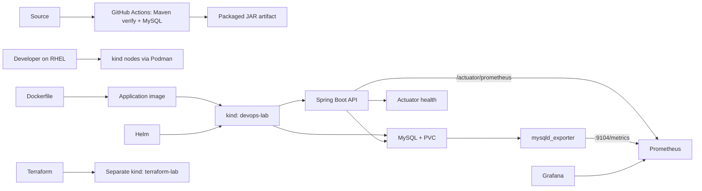

# Crewmeister DevOps challenge

Packages and runs the supplied Java 17 Spring Boot user API with MySQL on a local kind cluster. The core tools are Docker-compatible image packaging, Helm deployment, Terraform-managed kind infrastructure, and a local Kubernetes workflow.



## Run locally

The startup helper starts the existing kind node container if needed, waits up to three minutes for a Ready node, then reports nodes, pods, and Helm releases. It does not create or reset a cluster or redeploy the application.

```bash
./scripts/start-devops-lab.sh
```

After a VM restart, run `./scripts/verify-devops-lab.sh` for a bounded, non-destructive workload, storage, Service, Helm, and health check. See the [local operations guide](docs/LOCAL-OPERATIONS-GUIDE.md) for full recovery steps, API and MySQL checks, and troubleshooting.

To package the application, build an image, and make it available to kind:

```bash
./mvnw --batch-mode -DskipTests package
podman build -t localhost/crewmeister-app:0.2 .
podman save --format docker-archive --output /tmp/crewmeister-app-0.2.tar localhost/crewmeister-app:0.2
KIND_EXPERIMENTAL_PROVIDER=podman kind load image-archive --name devops-lab /tmp/crewmeister-app-0.2.tar
```

Helm is the canonical application deployment. Before installing, create the Kubernetes Secret from a local password file (never commit that file):

```bash
kubectl --context kind-devops-lab create secret generic mysql-auth \
  --from-file=root-password="$HOME/.config/crewmeister/mysql-root-password" \
  --dry-run=client -o yaml | kubectl --context kind-devops-lab apply -f -
helm upgrade --install crewmeister ./helm/crewmeister \
  --kube-context kind-devops-lab
```

Verify the deployment and health endpoint:

```bash
kubectl --context kind-devops-lab get pods
kubectl --context kind-devops-lab port-forward service/crewmeister-app 8080:8080
# In another terminal:
curl --fail http://localhost:8080/actuator/health
```

The chart defines readiness and liveness probes against Actuator health. A health check answers whether the application reports itself ready; it does not collect or graph historical measurements.

### Monitoring

Actuator and Micrometer expose application health and metrics. Prometheus scrapes `/actuator/prometheus` and the MySQL exporter every 30 seconds; the **Crewmeister Application** Grafana dashboard shows application traffic, JVM/runtime, the app-side Hikari pool, MySQL server counters, and scrape health. Verify both targets and a live MySQL metric through a loopback-only Prometheus port-forward:

```bash
kubectl --context kind-devops-lab -n monitoring port-forward --address 127.0.0.1 service/prometheus 19090:9090
# In another terminal:
curl --fail --silent --show-error http://127.0.0.1:19090/api/v1/targets?state=active
curl --fail --silent --show-error --get --data-urlencode 'query=process_uptime_seconds{job="crewmeister-app"}' http://127.0.0.1:19090/api/v1/query
curl --fail --silent --show-error --get --data-urlencode 'query=mysql_up{job="mysql-exporter"}' http://127.0.0.1:19090/api/v1/query
```

Both targets should report `health: up`, and `mysql_up` should return `1`. Open Grafana with `kubectl --context kind-devops-lab -n monitoring port-forward --address 127.0.0.1 service/grafana 13000:3000`, then visit `http://127.0.0.1:13000/d/crewmeister-app/crewmeister-application`. Grafana is anonymous Viewer-only and loopback-bound. Prometheus/Grafana history uses bounded ephemeral storage; this is local visibility, not backup or external alerting. See the [operations guide](docs/LOCAL-OPERATIONS-GUIDE.md#7-prometheus-and-grafana) for recovery and troubleshooting.

## Architecture and responsibilities

- **Dockerfile:** packages the Maven-built Java application into a container image.
- **kind and Podman:** provide the local Kubernetes environment on the RHEL VM.
- **Helm:** deploys Crewmeister and MySQL, including a PVC, to `devops-lab`.
- **Terraform:** provisions the separate `terraform-lab` kind cluster. It does not currently manage the Helm release.
- **GitHub Actions:** runs Maven `verify` with MySQL and separately validates the Helm chart, monitoring YAML/dashboard JSON, and shell syntax on temporary GitHub-hosted Ubuntu runners, separate from the RHEL VM. It uploads the JAR; it does not build/publish an image or deploy it.
- **Actuator:** serves application health information used by Kubernetes probes and manual checks.
- **Prometheus:** scrapes the app’s `/actuator/prometheus` endpoint every 30 seconds; its local TSDB retains at most three days and 384 MB on bounded ephemeral storage.
- **MySQL exporter:** uses a dedicated MySQL account supplied through a Kubernetes Secret; Prometheus scrapes server metrics at `mysql-exporter.monitoring.svc.cluster.local:9104/metrics`.
- **Grafana:** reads Prometheus and provisions a local dashboard for the application, JVM, Hikari pool, MySQL server, and scrape health. Access is anonymous, read-only, and intended only through a loopback-bound port-forward.
- **CD:** optional enhancement, not a core requirement. No automated deployment is configured.
- **AWS:** architecture/design consideration only; no AWS resources or deployment are implemented.

`k8s/` contains plain-manifest reference examples for the same app and database resources. They are not the deployment path; use the Helm chart as the source of truth to avoid maintaining two independently editable configurations. Both paths reference the `mysql-auth` Secret by name and key; neither stores its password value in source. A Kubernetes Secret keeps the value out of the manifest, but does not by itself guarantee encryption at rest.

## Challenge checklist

| Area | Status | Evidence / remaining work |
|---|---|---|
| Dockerfile | **Complete** | Java 17 image built locally as `localhost/crewmeister-app:0.2` and loaded into kind. |
| Helm chart | **Complete** | `helm/crewmeister` deploys the app, MySQL, Services, probes, and PVC; release `crewmeister` is deployed in `default`. |
| Terraform + Kubernetes | **Partial** | `terraform/kind-lab/main.tf` provisions a separate kind cluster. It does not manage the app Helm release. |
| Local Kubernetes with kind | **Complete** | `kind-devops-lab` node Ready; app/MySQL Pods Ready; `mysql-data` PVC Bound at 2Gi; health endpoint returned UP. |
| GitHub Actions CI (Plus) | **Complete** | Run for commit `6f94da3` completed successfully; workflow runs Maven `verify` with MySQL and uploads the JAR. |
| Monitoring (Plus) | **Complete** | Live Prometheus app and MySQL targets are UP; `mysql_up` is 1; exporter series are present. Grafana provisions the 21 data panels in the application/JVM/Hikari/MySQL/scrape dashboard. |

## Limits and verification notes

The local kind cluster is single-node. A PVC is not a database backup. Prometheus and Grafana use bounded ephemeral storage, so monitoring history is disposable. Terraform’s kind provider is local-only; cloud deployment would need a provider-specific cluster and authentication configuration. CD is optional and is not configured; AWS is design-only.

See [architecture](docs/02-architecture-design.md), [implementation notes](docs/CHALLENGES.md), and [checklist](docs/PROJECT_CHECKLIST.md) for concise evidence and remaining work.

For VM restart recovery, MySQL/API verification, port-forwarding, and troubleshooting, see the [local operations guide](docs/LOCAL-OPERATIONS-GUIDE.md).
