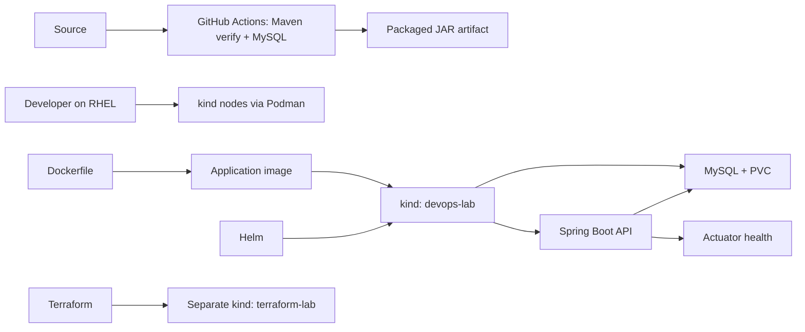

# Crewmeister DevOps challenge

Packages and runs the supplied Java 17 Spring Boot user API with MySQL on a local kind cluster. The core tools are Docker-compatible image packaging, Helm deployment, Terraform-managed kind infrastructure, and a local Kubernetes workflow.



## Run locally

The startup helper starts the existing kind node container if needed, waits up to three minutes for a Ready node, then reports nodes, pods, and Helm releases. It does not create or reset a cluster or redeploy the application.

```bash
./scripts/start-devops-lab.sh
```

After a VM restart, run `./scripts/verify-devops-lab.sh` for a bounded, non-destructive workload, storage, Service, Helm, and health check. See the [local operations guide](docs/LOCAL-OPERATIONS-GUIDE.md) for full recovery steps, API and MySQL checks, and troubleshooting.

To package the application, build an image, and make it available to kind:

```bash
./mvnw --batch-mode -DskipTests package
podman build -t localhost/crewmeister-app:0.1 .
kind load docker-image localhost/crewmeister-app:0.1 --name devops-lab
```

Helm is the canonical application deployment. Before installing, create the Kubernetes Secret from a local password file (never commit that file):

```bash
kubectl --context kind-devops-lab create secret generic mysql-auth \
  --from-file=root-password="$HOME/.config/crewmeister/mysql-root-password" \
  --dry-run=client -o yaml | kubectl --context kind-devops-lab apply -f -
helm upgrade --install crewmeister ./helm/crewmeister \
  --kube-context kind-devops-lab
```

Verify the deployment and health endpoint:

```bash
kubectl --context kind-devops-lab get pods
kubectl --context kind-devops-lab port-forward service/crewmeister-app 8080:8080
# In another terminal:
curl --fail http://localhost:8080/actuator/health
```

The chart defines readiness and liveness probes against Actuator health. A health check answers whether the application reports itself ready; it does not collect or graph historical measurements.

## Architecture and responsibilities

- **Dockerfile:** packages the Maven-built Java application into a container image.
- **kind and Podman:** provide the local Kubernetes environment on the RHEL VM.
- **Helm:** deploys Crewmeister and MySQL, including a PVC, to `devops-lab`.
- **Terraform:** provisions the separate `terraform-lab` kind cluster. It does not currently manage the Helm release.
- **GitHub Actions:** runs Maven `verify` (including the Spring context-load test, which starts Flyway) with MySQL on a temporary GitHub-hosted Ubuntu runner, separate from the RHEL VM. It uploads the JAR; it does not build/publish an image or deploy it.
- **Actuator:** serves application health information used by Kubernetes probes and manual checks.
- **Prometheus/Grafana:** not implemented. Prometheus would scrape a metrics endpoint and retain time-series measurements; Grafana would display those measurements in dashboards. There is no verified metrics endpoint or scrape target today.
- **CD:** optional enhancement, not a core requirement. No automated deployment is configured.
- **AWS:** architecture/design consideration only; no AWS resources or deployment are implemented.

`k8s/` contains plain-manifest reference examples for the same app and database resources. They are not the deployment path; use the Helm chart as the source of truth to avoid maintaining two independently editable configurations. Both paths reference the `mysql-auth` Secret by name and key; neither stores its password value in source. A Kubernetes Secret keeps the value out of the manifest, but does not by itself guarantee encryption at rest.

## Challenge checklist

| Area | Status | Evidence / remaining work |
|---|---|---|
| Dockerfile | **Complete** | Java 17 runtime image; local Podman build is recorded in `docs/CHALLENGES.md`. Rebuild to verify current local environment. |
| Helm chart | **Complete** | `helm/crewmeister` defines app, MySQL, Services, probes, and PVC. Live release not verified in this review. |
| Terraform + Kubernetes | **Partial** | `terraform/kind-lab/main.tf` provisions a separate kind cluster. It does not manage the app Helm release. |
| Local Kubernetes with kind | **Complete** | `devops-lab` and Helm deployment are documented as previously verified; current live cluster was not reachable during the last audit. |
| GitHub Actions CI (Plus) | **Partial** | Workflow runs Maven verification with MySQL and uploads a JAR. Current remote run status is unverified. |
| Monitoring (Plus) | **Partial** | Actuator health and Kubernetes probes are configured. No Prometheus scraping or Grafana dashboards. |

## Limits and verification notes

The local kind cluster is single-node. A PVC is not a database backup. Terraform’s kind provider is local-only; cloud deployment would need a provider-specific cluster and authentication configuration. The workflow source is present, but GitHub execution status must be checked on the repository’s Actions page.

See [architecture](docs/02-architecture-design.md), [implementation notes](docs/CHALLENGES.md), and [checklist](docs/PROJECT_CHECKLIST.md) for concise evidence and remaining work.

For VM restart recovery, MySQL/API verification, port-forwarding, and troubleshooting, see the [local operations guide](docs/LOCAL-OPERATIONS-GUIDE.md).
