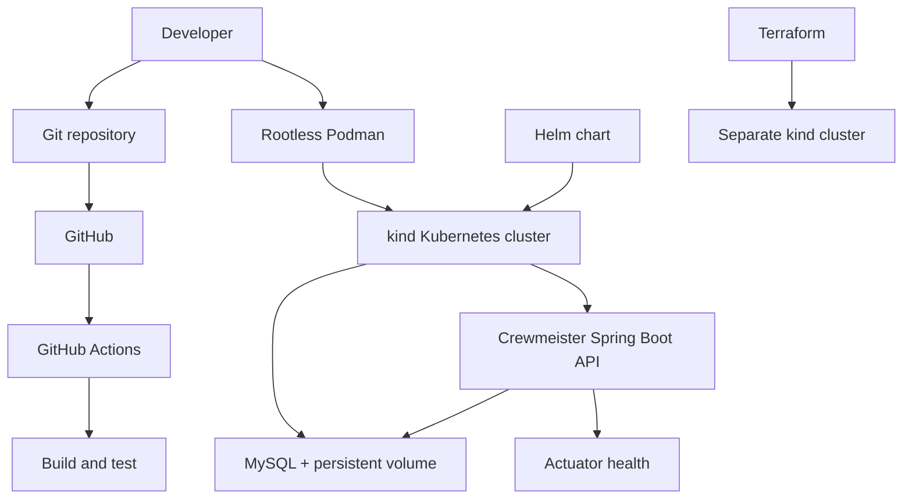

# Crewmeister DevOps Coding Challenge

A local-first DevOps implementation for the Crewmeister Spring Boot user-management API. This project demonstrates containerization, Kubernetes deployment, infrastructure provisioning, and automated build-and-test checks.

## Challenge requirements

| Challenge requirement | Implementation |
|---|---|
| Dockerfile | Container image for the Spring Boot application |
| Helm chart | `helm/crewmeister` deploys the application and MySQL |
| Terraform interacting with Kubernetes | Terraform provisions a local kind cluster |
| Local-machine operation | Rootless Podman and kind on RHEL |
| CI pipeline (Plus) | GitHub Actions build-and-test workflow |
| Application health monitoring (Plus) | Spring Boot Actuator health endpoint |

**Implementation scope:** Terraform currently manages a separate kind cluster named `terraform-lab`. Helm deploys Crewmeister and MySQL into `devops-lab`. Terraform does not currently manage that Helm release.

## Architecture



## Why these tools?

- **Podman:** supports rootless container execution without requiring a Docker daemon.
- **kind:** provides a local Kubernetes environment using containers as nodes, avoiding a paid cloud dependency for development and verification.
- **Helm:** groups Kubernetes resources and configuration into a reusable release, simplifying deployment and upgrades.
- **Terraform:** demonstrates declarative and repeatable infrastructure provisioning.
- **MySQL with a persistent volume:** separates database storage from the application pod. A PVC provides persistence, but it is not a backup or high-availability strategy.
- **GitHub Actions:** automates build and test checks for pushes and pull requests.
- **Actuator:** exposes application health information for operational checks.

The local kind environment is intended for development and verification, not production high availability. The cluster is single-node.

## Application

The supplied application uses Java 17, Spring Boot 3.3.5, MySQL, Flyway, Spring Data JPA, Maven, and Spring Boot Actuator.

| Endpoint | Purpose |
|---|---|
| `POST /user` | Create a user |
| `GET /user?id=<id>` | Retrieve a user by ID |
| `/actuator/health` | Application health check |

## Repository guide

- [Architecture and design](docs/02-architecture-design.md) — architecture, design choices, and trade-offs.
- [Containerization notes](docs/03-containerization-option-a.md) — containerization approach and evidence.
- [Challenges and decisions](docs/CHALLENGES.md) — implementation challenges and decisions.
- [Project checklist](docs/PROJECT_CHECKLIST.md) — implementation progress and remaining work.
- [Helm chart](helm/crewmeister/) — application and MySQL deployment configuration.
- [Terraform configuration](terraform/kind-lab/) — local kind cluster provisioning.
- [Startup script](scripts/start-devops-lab.sh) — start and verify the existing lab.
- [GitHub Actions workflow](.github/workflows/ci.yml) — automated build and test workflow.

## Local lab

The `devops-lab` cluster runs Crewmeister and MySQL using the Helm release `crewmeister`.

Start and verify the existing lab:

```bash
./scripts/start-devops-lab.sh
```

Check the user-level startup service:

```bash
systemctl --user status devops-lab-startup.service --no-pager
```

The service is a systemd oneshot unit. `active (exited)` with a successful exit status means the startup and verification script completed.

## CI

GitHub Actions runs the Maven build and tests on pushes and pull requests. The Spring Boot context test requires MySQL because Flyway initializes the database during application startup. The CI job therefore needs a MySQL service.

## Limitations and next steps

- Terraform does not yet manage the application Helm release.
- The local kind cluster is single-node and does not provide node-level high availability.
- Persistent storage is not a database backup strategy.
- Prometheus and Grafana are not currently deployed.
- CI is considered verified only after the workflow passes with its MySQL service configured.

## Challenge submission

This project uses locally runnable tools and does not require a paid cloud environment for the local lab. The repository is intended to document the implementation, its verification, and its current limitations.

