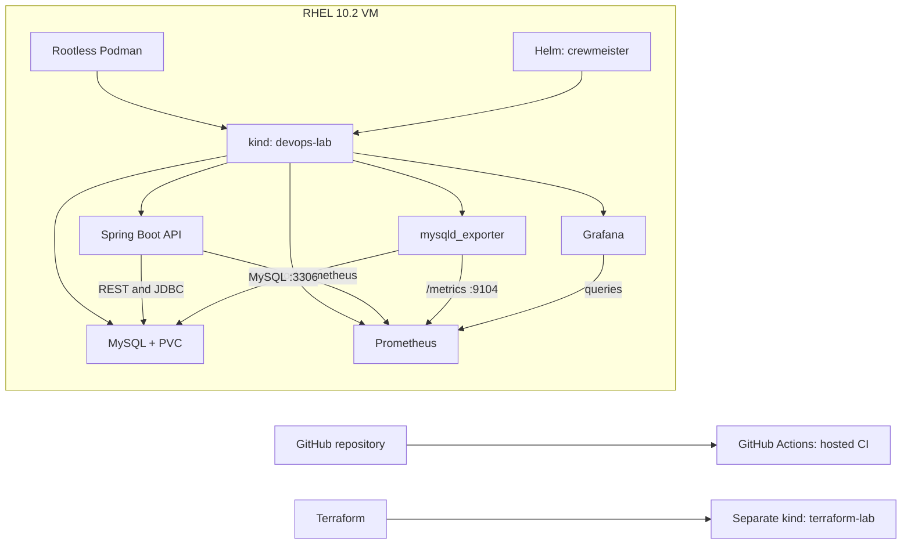
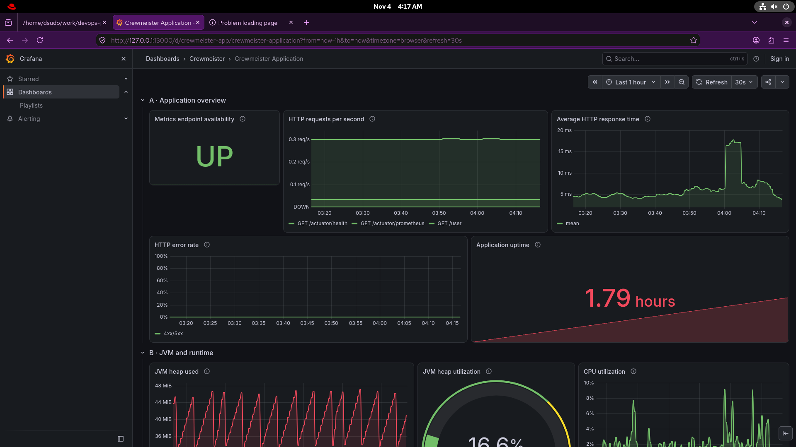

# Crewmeister DevOps challenge

This project packages and deploys the supplied Java 17 Spring Boot user API with MySQL on local Kubernetes. It uses rootless Podman and kind on RHEL, Helm for the app release, Terraform for a separate kind lab, GitHub Actions for hosted CI, and Prometheus/Grafana for monitoring.

The [challenge brief](https://raw.githubusercontent.com/crewmeister/devops-coding-challenge/main/README.md) names a Dockerfile, Helm chart, and Terraform/Kubernetes as core tools; GitHub CI and application-health monitoring are Plus items.

## Architecture



Helm deploys Crewmeister and MySQL into `devops-lab`; Terraform creates the separate `terraform-lab` cluster and does not manage the Crewmeister release. GitHub Actions runs on a temporary hosted runner, separate from the RHEL VM, and does not deploy to the local cluster.

## Technology choices

| Choice | Why it fits this project | Main trade-off |
|---|---|---|
| Rootless Podman | Available and practical on RHEL; daemonless CLI supports the local image workflow. | Rootless networking and storage differ from Docker in some cases; this is not a claim that one runtime is universally safer. |
| kind | Runs Kubernetes nodes as containers for repeatable local testing. | The current cluster has one node and is not highly available. |
| Helm | One chart is the canonical app/MySQL deployment, with values and release history. | The raw `k8s/` files are reference examples only; treating them as a second deployment path would create drift. |
| Terraform | Declaratively provisions the separate local `terraform-lab` cluster. | The current kind provider is local-only; Terraform does not deploy the app release or cloud infrastructure. |
| MySQL + PVC | Simple stateful database for the supplied API; the claim survives Pod replacement. | One MySQL instance, no failover, and no backup or disaster-recovery system. |
| GitHub Actions | Tests the project in a clean hosted environment with a temporary MySQL service. | CI does not build/publish an image or deploy to the local kind cluster. |
| Actuator, Prometheus, Grafana | Health probes report readiness; Prometheus stores metrics and Grafana displays them. | Local, bounded, ephemeral monitoring; no external alerting or durable history. |

## Quick start

On the configured VM, recover and verify the existing cluster and workloads:

```bash
./scripts/verify-devops-lab.sh
```

The script starts the existing kind node if needed and checks app/MySQL readiness, the PVC, Helm release, health endpoint, and monitoring. It does not create or reset clusters. To deploy the chart, the app image must already be loaded into kind and the `mysql-auth` Secret must exist:

```bash
helm upgrade --install crewmeister ./helm/crewmeister --kube-context kind-devops-lab
```

For a fresh lab, image loading, Secret provisioning, API calls, and VM-restart recovery steps are in the [local operations guide](docs/LOCAL-OPERATIONS-GUIDE.md).

## Monitoring

Actuator exposes health for Kubernetes probes and Micrometer metrics at `/actuator/prometheus`. Prometheus scrapes the application Service and MySQL exporter every 30 seconds. Live checks confirmed both targets `UP`, `mysql_up` equal to `1`, and MySQL server metric series. Grafana’s **Crewmeister Application** dashboard has panels for HTTP traffic/errors/latency, JVM, the application-side Hikari pool, MySQL server metrics, and scrape health.

Access Grafana through a loopback-only port-forward at `http://127.0.0.1:13000/d/crewmeister-app/crewmeister-application`. Run `./scripts/verify-devops-lab.sh` to verify the targets and a live MySQL query through Grafana.



*The capture shows the visible application overview and JVM/runtime panels. The MySQL section is below the captured viewport, so this image is not evidence of MySQL metrics.*

## CI

[Crewmeister CI run for commit `936d329`](https://github.com/DaudCloud-sudo/crewmeister-devops-challenge/actions/runs/41765219947) passed. GitHub Actions runs Maven `verify` with a temporary MySQL service, validates shell syntax and monitoring YAML/dashboard JSON, and lints/renders the Helm chart. It uploads the JAR; it does not publish an image or deploy.

## Challenge requirements

| Requirement | Status | Evidence |
|---|---|---|
| Dockerfile | **Complete** | Java 17 runtime image; `localhost/crewmeister-app:0.2` was built and loaded into kind. |
| Helm chart | **Complete** | `helm/crewmeister` deploys the app, MySQL, Services, probes, and PVC; release `crewmeister` is deployed. |
| Terraform with Kubernetes | **Partial** | `terraform/kind-lab/main.tf` provisions `terraform-lab`; it does not manage the Crewmeister release. The brief does not explicitly require Terraform to manage that Helm release. |
| Local Kubernetes | **Complete** | Live verification found `kind-devops-lab` Ready, app/MySQL Pods Ready, `mysql-data` Bound, and Actuator health UP. |
| GitHub Actions CI (Plus) | **Complete** | The linked run passed Maven/MySQL tests and configuration validation. |
| Monitoring (Plus) | **Complete** | App and exporter targets are UP; `mysql_up=1`; Grafana returned live MySQL query data. |

## Limitations and next steps

This is a local single-node kind environment. MySQL is one instance backed by a PVC: Pod restarts retain the claim, but the setup provides neither database failover nor backups. Prometheus/Grafana history is ephemeral. No cloud deployment or automated CD is configured.

An optional next phase can compare AWS production architectures and CD approaches, including cost and availability trade-offs. It is outside this challenge implementation; no AWS resources have been provisioned.

## Detailed documentation

- [Architecture decisions](docs/02-architecture-design.md)
- [Implementation and challenge notes](docs/CHALLENGES.md)
- [Local operations and troubleshooting](docs/LOCAL-OPERATIONS-GUIDE.md)
- [Podman networking experiment](docs/03-containerization-option-a.md)

## References and Development Transparency

- **Technical References:** [official documentation relevant to the project](docs/REFERENCES.md).
- **Responsible AI Usage:** [Codex assistance, engineering ownership, and validation](docs/AI-USAGE.md).
