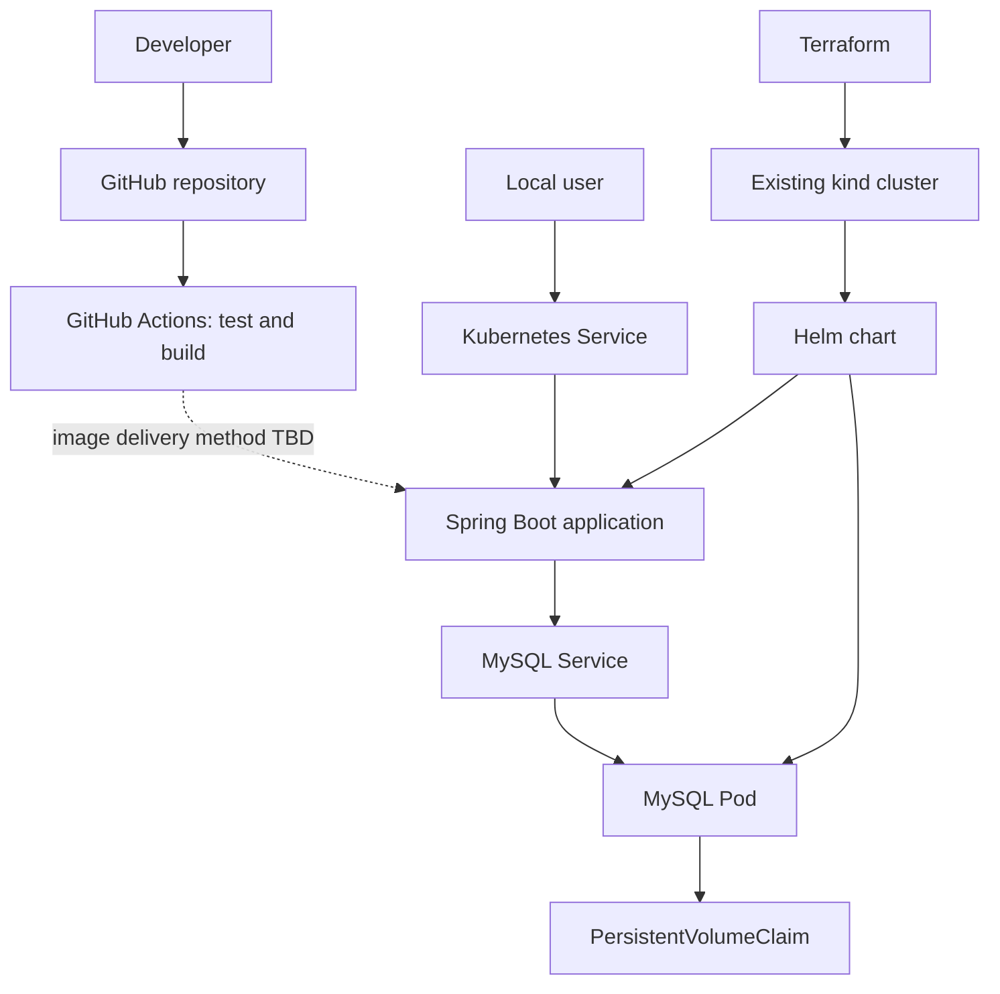

# 02 — Architecture & Design

## Target architecture

The first implementation is local-first. A single-node kind cluster provides a repeatable Kubernetes environment on the RHEL VM.

## Responsibilities

- **Spring Boot:** provides the supplied user API and application logic.
- **MySQL:** stores application data; persistence is provided through a PVC.
- **kind:** runs the local Kubernetes cluster.
- **Helm:** packages and configures the application and database workloads.
- **Terraform:** manages selected resources in the existing cluster.
- **GitHub Actions:** will test and build the application.
- **Actuator:** provides application health endpoints; monitoring integration is not yet verified.

## Constraints and trade-offs

- A single-node kind cluster is suitable for local verification, not node-level high availability.
- A PVC provides persistence, not a database backup.
- A VMware snapshot is an environment recovery point, not an application rollback or database backup.
- Keep the starter API behavior unchanged unless an optional change is approved.

## Decisions still open

- Container runtime on RHEL.
- Image delivery into kind: `kind load` or a local registry.
- Application access method.
- Terraform state location and exact resource ownership.
- Whether to add Prometheus and Grafana.
- Whether to use AWS after the local workflow is verified.
