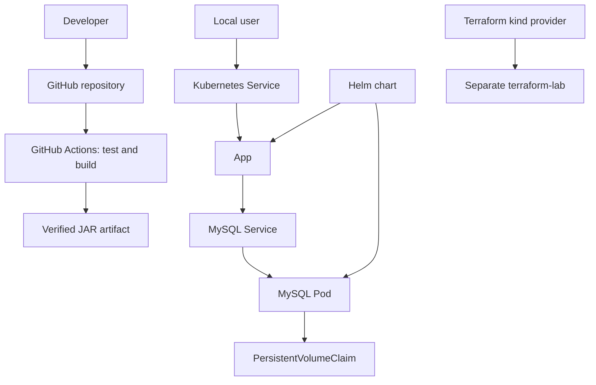

# 02 — Architecture & Design

## Target architecture

The first implementation is local-first. A single-node kind cluster provides a repeatable Kubernetes environment on the RHEL VM.

## Responsibilities

- **Spring Boot:** provides the supplied user API and application logic.
- **MySQL:** stores application data; persistence is provided through a PVC.
- **kind:** runs the local Kubernetes cluster.
- **Helm:** packages and configures the application and database workloads.
- **Terraform:** provisions a separate kind cluster named `terraform-lab`; it does not manage the application Helm release.
- **GitHub Actions:** runs Maven verification with MySQL on a temporary hosted runner and uploads the JAR; it does not deploy.
- **Actuator:** provides health information used by Kubernetes probes. Prometheus metrics scraping and Grafana are not implemented.

## Constraints and trade-offs

- A single-node kind cluster is suitable for local verification, not node-level high availability.
- A PVC provides persistence, not a database backup.
- A VMware snapshot is an environment recovery point, not an application rollback or database backup.
- Keep the starter API behavior unchanged unless an optional change is approved.

## Decisions still open

- AWS is a possible future deployment target; no AWS resources are provisioned.
- CD and metrics dashboards are optional enhancements.

## Local Lab Runtime and Startup

The local application environment uses rootless Podman with kind. The `devops-lab`
cluster hosts the Crewmeister application and MySQL, deployed through the Helm
release `crewmeister`.

The helper script `scripts/start-devops-lab.sh` starts the existing kind node
container when necessary, waits at most 180 seconds for a Ready Kubernetes node,
and reports nodes, pods, and Helm releases. It does not create or reset a cluster.

A user-level systemd oneshot service, `devops-lab-startup.service`, invokes this
script at user startup. Its `active (exited)` state with a successful exit status
indicates that the startup and verification operation completed.

Terraform currently manages a separate kind cluster named `terraform-lab` through
`terraform/kind-lab`. This Terraform-managed cluster is distinct from the
`devops-lab` cluster hosting the Helm deployment. Terraform does not currently
manage the Helm release or application resources in `devops-lab`.

