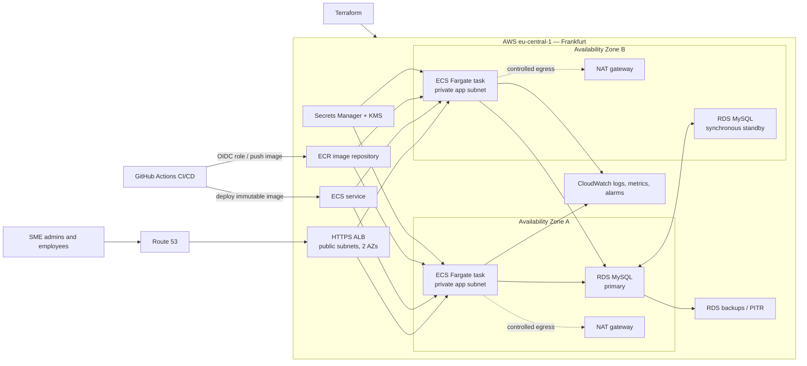

# Optional AWS Production Architecture and CD Design

**Status: design only.** This document proposes a production direction for the sample Spring Boot/MySQL API. It does not provision AWS resources, deploy the application, or claim that this is Crewmeister GmbH's actual service architecture.

## Public Crewmeister context

Crewmeister describes its product as time tracking, shift planning, and absence management for small businesses. Its public [data-protection page](https://crewmeister.com/de/dsgvo) says customer data is stored in AWS in the Frankfurt region, encrypted in transit and at rest, and not stored or transferred outside the EU. The page also identifies AWS and 1Blue Hosting in its approved processor history. This is useful context for a Germany-focused SME service, but it does not disclose AWS service names, VPC layout, Availability Zone count, database engine, or deployment pipeline.

The company-hosted [2022 technical and organisational measures document](https://crewmeister.com/en/dsgvo/toms-en-082022.pdf) describes an internal data center for internal IT systems. That is dated internal-systems information and should not be treated as a description of customer product hosting. AWS also has a similarly named [Crew Management Systems reference architecture](https://docs.aws.amazon.com/reference-architecture-diagrams/latest/crew-management-systems/crew-management-systems.html) for airline crew operations; it is unrelated to Crewmeister GmbH. The design below is therefore an independent proposal based on public product context and this repository's application.

## Recommendation

Use **Amazon ECS on AWS Fargate** for the stateless API and **Amazon RDS for MySQL Multi-AZ** for its database in `eu-central-1` (Frankfurt). Put an Application Load Balancer (ALB) in public subnets across two Availability Zones; run at least two application tasks in private subnets across those zones; keep the database in private database subnets. Store images in ECR. Use Terraform for AWS infrastructure and GitHub Actions with OIDC for CI/CD.

This sample is a small Spring Boot API with no Kubernetes-specific application dependency. ECS/Fargate gives it managed task placement and scaling without an EKS control plane and worker-node fleet. EKS remains a defensible alternative if Kubernetes itself is a product requirement or the organization already operates EKS; it is not the smallest operational step for this one service. ECS on EC2 can reduce compute cost at sustained utilization, but adds host capacity, patching, and scaling work.

The DB primary and standby are a single managed RDS Multi-AZ DB instance deployment: the standby provides failover, not read scaling. An RDS Multi-AZ DB cluster with readable standbys, Aurora MySQL, read replicas, or RDS Proxy are later choices only if measured throughput or connection patterns justify their extra cost and complexity.

## Component responsibilities

| Component | Responsibility and boundary |
|---|---|
| Route 53, ACM, ALB | Resolve the API hostname, terminate HTTPS, route HTTP to healthy ECS targets, and provide a stable public entry point. Redirect HTTP to HTTPS. Consider AWS WAF only after defining abuse controls and its added cost. |
| ECS/Fargate service | Run at least two stateless API tasks, distributed across two AZs; use health checks and target-tracking scaling. Keep the minimum at two for AZ resilience. Start with a measured maximum, not unbounded scaling. |
| ECR | Store immutable images tagged with the source commit SHA. Keep a limited number of recent release and rollback images with a lifecycle policy. |
| RDS MySQL Multi-AZ | Managed MySQL primary and standby across AZs, private-only access, encrypted storage, automated backups, and point-in-time recovery. Start with standard RDS MySQL rather than Aurora until workload tests show a need. |
| Secrets Manager, KMS, IAM | Store DB credentials outside Git and image layers; inject only the required secret into the task. Separate the ECS execution role from the app task role and grant each least privilege. Encrypt RDS and backups with KMS and require TLS for DB connections. |
| CloudWatch | Centralize application logs and service metrics; alert on failed health checks, elevated 5xx/latency, ECS task count, CPU/memory, RDS connections/storage/failover, and backup failures. Retain logs for an explicit period. |
| Terraform | Provision the VPC/subnets/security groups, ALB, ECS, ECR, RDS, IAM, logging, alarms, and secrets metadata as reviewed infrastructure changes. Keep Terraform state remote, encrypted, access-controlled, versioned, and locked; never commit state or secret values. |

Use security-group references rather than broad CIDR rules: the ALB accepts public HTTPS; app tasks accept the application port only from the ALB security group; RDS accepts MySQL only from the app security group. Tasks and RDS receive no public IP. Use VPC endpoints for AWS service traffic where their fixed endpoint charges compare favorably with NAT processing and egress. Keep egress local to each AZ when using per-AZ NAT gateways to avoid unnecessary cross-AZ data charges.

## Availability, recovery, and production gaps

- **Task or AZ failure:** ECS replaces unhealthy tasks; ALB routes only to healthy targets. With two tasks across two AZs, one task/AZ can fail while the other continues serving, subject to surviving capacity and database availability.
- **Database instance/AZ failure:** RDS Multi-AZ promotes the standby and updates the DB endpoint. Existing connections can break during failover; the application must reconnect with bounded retries and sensible DNS/connection-pool behavior. Failover is not zero-downtime.
- **Bad release:** ECS deployment circuit-breaker and CloudWatch alarm rollback return to the last healthy task revision. Keep immutable images and test the rollback path.
- **Data loss or logical corruption:** Multi-AZ replication also replicates logical writes; it is not a backup. Configure RDS automated backups/PITR, retention, encryption, and scheduled restore tests. A copied cross-region backup is a separate DR option with extra cost and a documented RPO/RTO.
- **Regional outage:** The recommended first production step is multi-AZ in one region, not active-active multi-region. Define business RPO/RTO and test restore first. Add cross-region backup/standby only if customer commitments justify its cost and operational burden.

Proposed initial service objectives (to be confirmed with product/business owners) are 99.9% monthly API availability, RTO under one hour, and RPO under 15 minutes. These are design targets, not AWS guarantees. Multi-AZ improves fault tolerance but does not by itself meet an end-to-end SLA.

### Application changes required before real customer data

The repository currently exposes `GET /user` and `POST /user` and uses MySQL/Flyway. It does not implement authentication or tenant authorization, and the simple `User` model is not a tenant-isolated workforce data model. Do not expose this sample unchanged to customer or employee records.

Before a production pilot:

1. Add OIDC/JWT authentication and enforce tenant authorization server-side on every read and write. Select Cognito or an existing identity provider only after the product identity and account model are defined.
2. Add tenant identifiers, database constraints, audit events, input validation, rate controls, and privacy lifecycle behavior (export, correction, retention, and deletion) appropriate to workforce data.
3. Replace the local root database account with a least-privilege runtime account; use a separate migration account. Store both in Secrets Manager and rotate them safely.
4. Move Flyway migrations to one controlled pre-deployment task or another single-run migration step. Use backward-compatible expand/migrate/contract changes so old and new tasks can overlap during a rolling deployment.
5. Use the Actuator readiness endpoint for ALB target health and ECS deployment checks; keep liveness/readiness behavior distinct and restrict management endpoints. Load-test task sizing, DB connection limits, and failure recovery before setting autoscaling thresholds.

## CD design

Keep CI and release deployment as separate jobs. The existing workflow runs Maven `verify` with a disposable MySQL service, configuration checks, shell syntax validation, and Helm lint/render checks. Before using this proposed AWS CD flow, extend CI with Docker image build validation and Terraform formatting/validation/plan for infrastructure changes. Pull requests should not receive production deployment credentials.

After a reviewed merge to the protected release branch:

1. Build the application image once; tag it with the full Git SHA and push to ECR. Do not deploy `latest` or rebuild a different image for production. Run image vulnerability scanning and retain the scan result with the build metadata.
2. Use GitHub Actions OIDC to assume a short-lived, repository/ref/environment-scoped AWS role. Do not store long-lived AWS access keys in GitHub secrets. Give the build role ECR push permissions only; give the deployment role access only to the intended ECS service/task definition.
3. Deploy to a staging ECS service, apply any approved backward-compatible migration as a single task, wait for ECS steady state, then run smoke checks against `/actuator/health/readiness` and representative API operations.
4. Promote the exact same image digest to production through a protected GitHub Environment approval. Use an ECS rolling deployment with minimum healthy capacity preserved, health-check grace, deployment circuit breaker, and CloudWatch alarms for target health/5xx/latency. Automatically roll back a failed rollout.
5. Record the image SHA, Terraform plan/apply reference, migration version, approval, and health result. Keep rollback as a previous image/task revision; database rollback is handled through forward-compatible migrations or a separately tested restore procedure.

For a small team, GitHub Actions is the simplest CD controller because it already runs CI and AWS OIDC avoids permanent credentials. AWS CodePipeline/CodeBuild/CodeDeploy is a reasonable alternative if release controls should live entirely in AWS. Start with ECS rolling deployment; add CodeDeploy blue/green with a test listener only if the release risk or downtime objective justifies running both revisions and the additional deployment configuration.

Terraform should use a separate AWS root/module set and remote state from the existing `terraform/kind-lab` state. Infrastructure PRs run `fmt`, `validate`, and a saved plan; applying infrastructure is a separately approved operation. Do not combine Terraform infrastructure changes, database migrations, and application promotion into one opaque step.

## Example monthly cost structure

The figures below are **planning ranges, not a quote or load-tested capacity estimate**. They illustrate the cost shape of a continuously available Frankfurt deployment. Assumptions: on-demand Linux/x86, 730 hours/month, two AZs, no AWS Free Tier, before VAT/tax, with moderate request volume. Actual prices depend on the selected DB class, request/response bytes, log volume/retention, backup retention, NAT traffic, and outbound internet transfer. Use the [AWS Pricing Calculator](https://calculator.aws/#/) with the final sizes before any deployment.

The Fargate figures below are rounded **budget allowances**, not prices retrieved from a live AWS quote. The official pricing page bills requested vCPU, memory, operating system, CPU architecture, and storage by task duration; exact commercial `eu-central-1` rates should be entered in the AWS Pricing Calculator before approval. The allowances exclude extra ephemeral storage and all other services. Totals are sums of the rounded component ranges, with a small margin for rounding.

| Monthly line item | Small HA example | Growth example |
|---|---:|---:|
| Example load (illustrative only) | 100 SMEs / 1,000 employees; 5 average and 25 peak requests/second | 1,000 SMEs / 10,000 employees; 20 average and 100 peak requests/second |
| ECS Fargate API | 2 tasks × 0.5 vCPU/1 GB: **~€40–70 allowance** | 4 average tasks × 1 vCPU/2 GB, autoscaling range 2–20: **~€160–330 allowance at four tasks**; more if average task-hours rise |
| ALB | **€20–50** allowance | **€30–100** allowance, driven by LCU usage |
| RDS MySQL Multi-AZ, storage and backup | **€150–300** allowance; small class and ~50 GB storage, size to test results | **€300–700** allowance; larger class and ~200 GB storage, capacity not established by this sample |
| NAT gateways and processed traffic | **€70–120+** allowance for two AZs | **€80–180+** allowance; egress and NAT bytes can exceed this |
| CloudWatch logs, metrics, alarms | **€10–40** with bounded retention | **€50–200** depending on logs and metric volume |
| ECR, Secrets Manager, KMS, DNS, backups and data transfer | **€20–80** allowance | **€80–300+** allowance |
| **Indicative monthly total** | **~€300–700** | **~€700–1,900+** |

These load figures are examples for a price model, not claims that the current application can serve those rates. The RDS, ALB, NAT, and telemetry amounts are deliberately wide planning allowances; AWS bills by task resource-hours, database instance-hours, storage/backup, load-balancer capacity units, bytes, and log/metric use. The estimate excludes optional WAF, RDS Proxy, cross-region DR, support plans, and taxes. Recalculate the design in the [AWS Pricing Calculator](https://calculator.aws/#/) using current Frankfurt prices. AWS documents [Fargate pricing](https://aws.amazon.com/fargate/pricing/), [ALB pricing](https://aws.amazon.com/elasticloadbalancing/pricing/), [VPC/NAT pricing](https://aws.amazon.com/vpc/pricing/), and [RDS for MySQL pricing](https://aws.amazon.com/rds/mysql/pricing/).

### Cost controls

- Keep two API tasks as the availability floor; scale against CPU and ALB requests per target, with a tested maximum and DB-aware limits. Do not scale a production service to zero.
- Right-size from load tests and production telemetry. Consider Graviton Fargate after building and testing the image on ARM64; use Savings Plans only after a stable baseline and commitment review.
- Preserve two AZs for the ALB, app, and RDS standby. Compare per-AZ NAT gateways with VPC endpoints for ECR, S3, CloudWatch, and Secrets Manager; endpoints also have charges, so compare expected traffic before choosing.
- Set CloudWatch log retention and alarm scope, avoid high-cardinality custom metrics, and apply ECR lifecycle rules to old images.
- Use a bounded RDS backup retention aligned to approved recovery objectives. Periodically test restores; do not retain snapshots indefinitely by default.
- Do not add Aurora, read replicas, RDS Proxy, EKS, a service mesh, or multi-region active/active until measurements or an agreed availability objective require them.

## Branch and repository workflow

`origin` is a Git remote name, not a branch. In this checkout, `origin` points to the original Crewmeister challenge repository and `github` points to the project repository. Keep pushing project work to `github`; do not push this implementation into the challenge source repository. `devops-implementation` is a clear submission branch. Renaming remotes or changing the default branch is not required for this design.

For a maintained product repository, the more conventional setup is the product repository as `origin`, the challenge/source repository as `upstream`, a protected `main` branch as the default integration branch, and short-lived feature branches merged by pull request. For this solo submission, keep the verified branch/remotes stable through review; consider that convention only as a separate repository housekeeping change.

## Further reading

- [Amazon ECS with Fargate](https://docs.aws.amazon.com/AmazonECS/latest/developerguide/AWS_Fargate.html), [ECS load balancing](https://docs.aws.amazon.com/AmazonECS/latest/developerguide/service-load-balancing.html), [AZ rebalancing](https://docs.aws.amazon.com/AmazonECS/latest/developerguide/service-rebalancing.html), and [target-tracking autoscaling](https://docs.aws.amazon.com/AmazonECS/latest/developerguide/service-autoscaling-targettracking.html).
- [RDS for MySQL Multi-AZ](https://docs.aws.amazon.com/AmazonRDS/latest/UserGuide/Concepts.MultiAZSingleStandby.html), [automated backups/PITR](https://docs.aws.amazon.com/AmazonRDS/latest/UserGuide/USER_WorkingWithAutomatedBackups.html), and [RDS Proxy](https://docs.aws.amazon.com/AmazonRDS/latest/UserGuide/rds-proxy.howitworks.html).
- [GitHub Actions OIDC with AWS](https://docs.github.com/en/actions/how-tos/secure-your-work/security-harden-deployments/oidc-in-aws), [GitHub deployment environments](https://docs.github.com/en/actions/reference/workflows-and-actions/deployments-and-environments), [ECS deployment rollback](https://docs.aws.amazon.com/AmazonECS/latest/developerguide/deployment-failure-detection.html), and [ECS secret injection](https://docs.aws.amazon.com/AmazonECS/latest/developerguide/specifying-sensitive-data.html).
