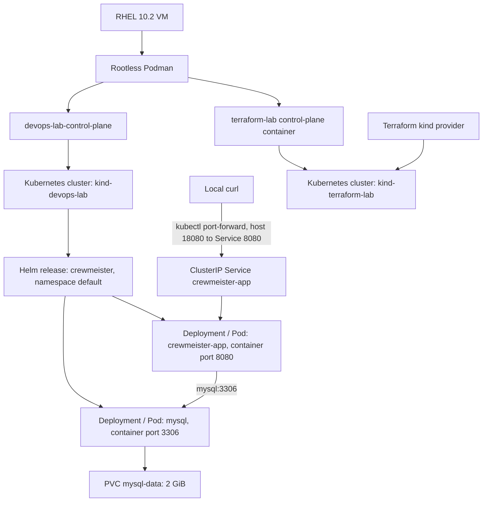

# Local VM restart and operations guide

This guide covers recovery and day-to-day checks for the RHEL VM. It uses the repository’s current names and configuration. The commands below do not delete or recreate clusters, remove PVCs, reset data, or change Terraform state. The `verify-devops-lab.sh` helper may start the existing `devops-lab` node container if it is stopped and creates a temporary local port-forward for its health check; it cleans up only that port-forward.

## 1. What runs where



- **RHEL VM:** the host that owns your user session, CLI tools, local files, and Podman storage. A VM restart ends any foreground `kubectl port-forward` process.
- **Rootless Podman containers:** kind uses containers as Kubernetes nodes. `devops-lab-control-plane` is confirmed by the startup script and live pod output. The expected Terraform node container name is `terraform-lab-control-plane`; discover it before starting it, because no live inspection of that cluster was possible here.
- **kind cluster and Kubernetes node:** `devops-lab` is the cluster; its node is `devops-lab-control-plane`. The kubeconfig context is `kind-devops-lab`. The other context is `kind-terraform-lab`.
- **Deployment and Pod:** a Deployment maintains the desired replicas; its Pod runs the container. Current chart Deployment names are `crewmeister-app` and `mysql` in namespace `default`.
- **Ports and Services:** app Pod/container port 8080 is exposed through ClusterIP Service `crewmeister-app` port 8080. MySQL container port 3306 is exposed internally by ClusterIP Service `mysql` port 3306. Neither Service is configured as NodePort or LoadBalancer, and neither chart Deployment declares `hostPort`.
- **PVC:** `mysql-data` requests 2 GiB, `ReadWriteOnce`, and mounts at `/var/lib/mysql`. A Bound PVC stores data outside the MySQL Pod lifecycle. It does not establish backup coverage or guarantee survival if its cluster/storage is deleted.
- **Helm:** release `crewmeister` deploys the app, MySQL, Services, probes, and PVC into `devops-lab` / `default`.
- **Terraform:** `terraform/kind-lab/main.tf` uses provider `elioseverojunior/kind` version `0.0.4` to create the separate kind cluster `terraform-lab`. It does not manage the Crewmeister Helm release in `devops-lab`. The locally recorded Terraform state lists `kind_cluster.lab`; that does not prove the cluster is currently running.
- **Monitoring:** the repository configures Actuator health and Kubernetes probes. It contains no Prometheus/Grafana deployment, Service, scrape configuration, dashboard, or Prometheus registry dependency. Do not expect a metrics target or dashboard from this project.

There is no checked-in kind cluster configuration file. The cluster names, node name, Helm chart, and Terraform resource are the configuration evidence available in this repository.

## 2. Recover after a VM restart

Run commands as the same non-root user that owns the rootless Podman containers. Do not use `sudo podman`; that addresses a different container store.

### 2.1 Check the tools and Podman user session

```bash
podman info >/dev/null && echo 'Podman is available'
podman ps -a --format 'table {{.Names}}\t{{.Status}}\t{{.Ports}}'
```

`podman info` checks that this user’s rootless runtime is usable. Podman is daemonless for normal CLI use; there is not necessarily a system-wide Podman service to start. The container list shows whether the kind node containers still exist, whether they are running, and any published host ports. Do not infer that the app is host-published from this output; the chart exposes a ClusterIP Service.

The project previously documented a user oneshot unit. Its unit file is not in this repository, and its current enabled/active state could not be queried from this audit environment. Check it if you configured it:

```bash
systemctl --user status devops-lab-startup.service --no-pager
systemctl --user is-enabled devops-lab-startup.service
```

If the unit is absent or not enabled, use the manual startup script below. `active (exited)` can be normal for a successful oneshot; check its result/status rather than expecting a long-running process.

### 2.2 Check kind clusters, contexts, and node containers

The `kind` CLI defaults to Docker unless the Podman provider is selected. Use the provider variable for kind commands on this VM:

```bash
KIND_EXPERIMENTAL_PROVIDER=podman kind get clusters
kubectl config get-contexts
podman ps -a --filter label=io.x-k8s.kind.cluster=devops-lab --format 'table {{.Names}}\t{{.Status}}'
podman ps -a --filter label=io.x-k8s.kind.cluster=terraform-lab --format 'table {{.Names}}\t{{.Status}}'
```

Expected names are `devops-lab` and `terraform-lab`; contexts are `kind-devops-lab` and `kind-terraform-lab` (both contexts were present in kubeconfig during inspection). The Podman label queries discover node container names without assuming their ports. If a label query returns nothing, inspect `podman ps -a` before taking action.

### 2.3 Start the existing application cluster

```bash
./scripts/start-devops-lab.sh
```

The script checks that `devops-lab-control-plane` exists, starts it only if stopped, waits at most 180 seconds for a Ready node, then lists nodes, pods, and Helm releases. It does not create, delete, reset, or redeploy cluster resources, so it is safe to run repeatedly. A nonzero exit means the node container is missing, the API did not become Ready before the deadline, or a later status command failed. If it times out, continue with the diagnostic commands in sections 3 and 8; do not recreate the cluster as a restart step.

Confirm API and node readiness:

```bash
kubectl --context kind-devops-lab cluster-info
kubectl --context kind-devops-lab get nodes -o wide
kubectl --context kind-devops-lab wait --for=condition=Ready nodes --all --timeout=180s
```

The expected app node is `devops-lab-control-plane`, status `Ready`. The user’s latest reported check showed Kubernetes `v1.37.0`; a future version may differ. `cluster-info` confirms API reachability; `wait` is bounded.

### 2.4 Start `terraform-lab` only when you need it

`terraform-lab` is independent of the application. You do not need it to run Crewmeister. First discover its node container using the label query above. If it exists and is stopped, start only that existing node container:

```bash
TF_NODE_CONTAINER=terraform-lab-control-plane # replace if the label query showed a different name
if podman container exists "$TF_NODE_CONTAINER"; then
  if [[ "$(podman inspect --format '{{.State.Running}}' "$TF_NODE_CONTAINER")" == "true" ]]; then
    echo "Terraform lab node is already running."
  else
    podman start "$TF_NODE_CONTAINER"
  fi
else
  echo "Terraform lab node container was not found; check the label query above."
  exit 1
fi
kubectl --context kind-terraform-lab wait --for=condition=Ready nodes --all --timeout=180s
kubectl --context kind-terraform-lab get nodes -o wide
```

The name `terraform-lab-control-plane` follows kind’s default node naming for the Terraform cluster name; it could not be confirmed live here. If the first command says the container does not exist or your label query returned a different name, substitute the exact discovered name. Run `podman start` only if inspection reports it is stopped. If it is already running, skip `podman start`. Do not run Terraform `apply`, `destroy`, or state-changing commands as a recovery method.

### 2.5 Confirm the app release and its dependencies

```bash
helm --kube-context kind-devops-lab list --all-namespaces
helm --kube-context kind-devops-lab -n default status crewmeister
kubectl --context kind-devops-lab -n default get deployments,pods,services,endpoints,pvc -o wide
```

Expect release `crewmeister` with status `deployed`; Deployments `crewmeister-app` and `mysql`; Services `crewmeister-app` and `mysql`; and PVC `mysql-data` with phase `Bound`. The latest user-provided live output confirmed both Pods `1/1 Running`, the PVC Bound at 2 GiB, and Helm release revision 3 deployed. Both Pods had elevated restart counts (12 for app, 10 for MySQL). Their recent events showed `NodeNotReady` and `SandboxChanged`; inspect events/logs if restarts continue.

### 2.6 Verify Actuator health

Open a separate terminal and run:

```bash
kubectl --context kind-devops-lab -n default port-forward --address 127.0.0.1 service/crewmeister-app 18080:8080
```

Leave it running. In another terminal:

```bash
curl --silent --show-error --write-out '\nHTTP %{http_code}\n' http://127.0.0.1:18080/actuator/health
```

The most recent live response was `{"status":"UP","groups":["liveness","readiness"]}`. The health endpoint checks application health contributors; a successful GET `/user` additionally checks the app-to-database read path. Neither alone proves a newly posted row is persisted. Stop the port-forward with Ctrl+C; this only stops the local forwarding process.

## 3. Environment inspection commands

All commands in this section are read-only.

| Command | What it shows / healthy result |
|---|---|
| `podman ps -a --format 'table {{.Names}}\t{{.Status}}\t{{.Ports}}'` | All user-owned containers, states, and published ports. The kind node container should exist; status should be Up when its cluster is in use. |
| `KIND_EXPERIMENTAL_PROVIDER=podman kind get clusters` | kind clusters visible through Podman. Expect `devops-lab`; `terraform-lab` is optional. |
| `kubectl config get-contexts` | Available contexts. Expect `kind-devops-lab` and `kind-terraform-lab`. |
| `kubectl --context kind-devops-lab get nodes -o wide` | Node health and IP. Expect `devops-lab-control-plane Ready`. |
| `kubectl --context kind-devops-lab get namespaces` | Namespaces. Project resources are in `default`. |
| `kubectl --context kind-devops-lab -n default get pods -o wide` | Pod phase, readiness, restarts, IP, and node. Expect one `crewmeister-app` and one `mysql`, each `1/1 Running`. |
| `kubectl --context kind-devops-lab -n default describe pod crewmeister-app-7b597fcd85-zjg6r` | Details/events for the current app Pod. The suffix changes after rollout; discover it with `get pods` and substitute. |
| `kubectl --context kind-devops-lab -n default get deployments` | Desired, updated, and available replicas. Expect 1 available for each deployment. |
| `kubectl --context kind-devops-lab -n default rollout status deployment/crewmeister-app --timeout=120s` | Waits up to two minutes for app rollout; run similarly for `deployment/mysql`. |
| `kubectl --context kind-devops-lab -n default get services -o wide` | Service types, ClusterIPs, and service ports. Both project Services should be ClusterIP. |
| `kubectl --context kind-devops-lab -n default get endpoints` | Ready backend IPs for Services. `crewmeister-app` and `mysql` should each have an address. |
| `kubectl --context kind-devops-lab -n default get endpointslices` | Current EndpointSlice backends; useful when checking selectors/readiness. |
| `kubectl --context kind-devops-lab -n default get pvc` | Claim status. Expect `mysql-data Bound`, request 2Gi, access mode RWO. |
| `kubectl --context kind-devops-lab get pv` | Cluster PV bound to the MySQL claim. Do not delete it during routine checks. |
| `kubectl --context kind-devops-lab get events -A --sort-by=.metadata.creationTimestamp` | Recent scheduling, probe, node, and volume events. Investigate repeated `NodeNotReady`, `Unhealthy`, or `FailedMount`. |
| `helm --kube-context kind-devops-lab list -A` | Helm release inventory. Expect `crewmeister` deployed in `default`. |
| `helm --kube-context kind-devops-lab -n default status crewmeister` | Release status and revision. It should report `deployed`. |
| `helm --kube-context kind-devops-lab -n default get values crewmeister` | User-supplied release values. Do not add secret values to Helm values. |
| `terraform -chdir=terraform/kind-lab state list` | Read-only list of addresses in the local Terraform state. The previously inspected state listed `kind_cluster.lab`; state presence does not prove the cluster is running. |
| `podman logs --tail=100 devops-lab-control-plane` | kind node/container runtime logs when Kubernetes itself is failing. |
| `kubectl --context kind-devops-lab -n default logs deployment/crewmeister-app --all-containers --tail=100` | Recent Spring Boot app logs. |
| `kubectl --context kind-devops-lab -n default logs deployment/crewmeister-app --previous --tail=100` | Previous app container logs after a restart. |
| `kubectl --context kind-devops-lab -n default logs deployment/mysql --all-containers --tail=100` | Recent MySQL startup/readiness logs. |
| `kubectl --context kind-devops-lab -n default logs deployment/mysql --previous --tail=100` | Previous MySQL container logs after a restart. |

Logs and `describe` output should not contain Secret values, but review before sharing them. Never run `kubectl get secret ... -o yaml` or paste decoded Secret data.

## 4. Ports and application access

- **Container/Pod port:** the app listens on 8080 in its container; MySQL listens on 3306. These are not host listeners.
- **Service port:** `crewmeister-app` maps Service port 8080 to target port 8080. `mysql` maps 3306 to 3306. Both are `ClusterIP`, intended for in-cluster access.
- **NodePort:** none is configured by this Helm chart.
- **Host port:** neither application chart Deployment declares `hostPort`; Dockerfile `EXPOSE 8080` is image metadata, not a host port publication.
- **kind control-plane port mapping:** the host API mapping is created by kind and may be dynamically assigned. Discover it with `podman port devops-lab-control-plane` and `podman inspect`; do not assume a fixed API port.
- **Port-forward:** `kubectl port-forward service/crewmeister-app 18080:8080` creates a temporary host listener on 127.0.0.1:18080 and forwards to the Service’s 8080 port. This local port is the one successfully used in the recent live check; it is not a persistent Service configuration.

Discover current host listeners and mappings:

```bash
podman port devops-lab-control-plane
podman ps --format 'table {{.Names}}\t{{.Ports}}'
ss -ltnp
ss -ltnp | grep -E ':(18080|8080)([[:space:]]|$)' || true
```

After a VM restart, a missing listener on 18080 is expected until you start the foreground port-forward again. If it fails, verify the context, API, Service, and endpoints; check whether the local port is occupied with `ss`. If 18080 is occupied, use another local port, for example `kubectl --context kind-devops-lab -n default port-forward --address 127.0.0.1 service/crewmeister-app 18081:8080`, then curl `http://127.0.0.1:18081/actuator/health`. Do not treat a ClusterIP as directly reachable from the RHEL host.

## 5. Health and API endpoints

`UserController` implements:

- `GET /user?id=<id>`: loads one user by ID and returns `Greetings from Crewmeister, <name>!`.
- `POST /user` with JSON containing a `name` string: saves a user and returns the greeting. The controller has no DTO or validation layer. A malformed body is caught and returned as `Error parsing JSON`; the controller does not set an error HTTP status in that catch path, so inspect the response body as well as the status.
- `GET /actuator/health`: Actuator health. It is exposed by `application.yml` and used by Kubernetes readiness and liveness probes.
- `GET /actuator/health/liveness` and `/actuator/health/readiness`: the latest live health response listed these groups. Verify their response on the current app before relying on them in automation.
- `/actuator/prometheus`: not configured as a working metrics endpoint. Although Actuator health is exposed, `pom.xml` has no Micrometer Prometheus registry and `/actuator/prometheus` has not been verified.

With the port-forward running, check health and HTTP status:

```bash
curl --silent --show-error --write-out '\nHTTP %{http_code}\n' http://127.0.0.1:18080/actuator/health
curl --silent --show-error --write-out '\nHTTP %{http_code}\n' http://127.0.0.1:18080/actuator/health/liveness
curl --silent --show-error --write-out '\nHTTP %{http_code}\n' http://127.0.0.1:18080/actuator/health/readiness
```

Use API POST/GET as described in section 6. Health `UP` is a point-in-time app status; it does not prove a specific row was committed. GET of a known user checks a database read; SQL inspection after POST proves the inserted row is present.

## 6. Insert and verify a MySQL record

The controller accepts a raw JSON body and reads exactly the `name` property. No other request field is required. The entity has generated numeric `id` and `name`; the migration creates table `user` and seeds ID 1 as Alice.

With the app port-forward running, submit one new test row:

```bash
curl --silent --show-error --write-out '\nHTTP %{http_code}\n' \
  -X POST http://127.0.0.1:18080/user \
  -H 'Content-Type: application/json' \
  --data-binary '{"name":"VM restart verification"}'
```

The controller’s normal success path returns HTTP 200 and `Greetings from Crewmeister, VM restart verification!`. This changes application data by adding one row. No DELETE endpoint is implemented, so choose a distinctive name and understand the row remains in the database.

Connect interactively to the MySQL container from its Pod. The Kubernetes Deployment injects the `mysql-auth` Secret key into the container as `MYSQL_ROOT_PASSWORD`; this command uses that already-injected value without displaying it:

```bash
kubectl --context kind-devops-lab -n default exec -it deployment/mysql -- \
  sh -c 'MYSQL_PWD="$MYSQL_ROOT_PASSWORD" exec mysql --user=root challenge'
```

At the `mysql>` prompt, inspect the table and locate the test row:

```sql
SELECT id, name FROM `user` ORDER BY id;
SELECT id, name FROM `user` WHERE name = 'VM restart verification' ORDER BY id DESC;
```

Record the returned `id`, then exit the client:

```sql
exit;
```

Retrieve that same row through the API, replacing `ID_FROM_QUERY` with the numeric ID you recorded:

```bash
curl --silent --show-error --write-out '\nHTTP %{http_code}\n' \
  'http://127.0.0.1:18080/user?id=ID_FROM_QUERY'
```

The expected body is `Greetings from Crewmeister, VM restart verification!` with HTTP 200. SQL confirms persistence in MySQL; GET confirms the application can read it back.

The MySQL Pod mounts `mysql-data` at `/var/lib/mysql`; a Pod restart keeps the claim and its storage attached. Check `kubectl get pvc mysql-data -n default` and expect `Bound`. A PVC is not a backup, and this guide makes no promise that data survives deleting/recreating a kind cluster or its storage backend.

Do not print Secret values. If you need to verify that the Secret object exists, use `kubectl get secret mysql-auth -n default` (metadata only). Do not use `-o yaml`, base64-decode the Secret to the terminal, or put its value in a command argument. If the Secret must be provisioned, use a secured local file as described in the README; never commit that file.

## 7. Prometheus and Grafana

Prometheus and Grafana are **not implemented in this repository**. There are no corresponding Helm charts/manifests, Services, scrape targets, or dashboard provisioning. The Prometheus registry dependency is absent, and `/actuator/prometheus` has not been verified. Therefore this project has no application metrics endpoint, Prometheus targets page, Grafana URL, login, or dashboard to document as working.

If you want to check whether unrelated monitoring Pods exist in the live cluster, use `kubectl --context kind-devops-lab get pods,services -A | grep -Ei 'prometheus|grafana'`. No matching resources means there is no in-cluster instance to open. Do not treat health `UP` as metrics scraping: health is a request-time status; a Prometheus target would need a configured scrape endpoint and show `UP` on its Targets page. Grafana would need a data source connected to that Prometheus server. None of those steps are project-supported today.

## 8. Troubleshooting

| Symptom | Diagnose | Safe next action |
|---|---|---|
| Podman unavailable | `podman info`; check current user/session and rootless runtime errors. | Use the same user that created the clusters. Do not switch to `sudo podman`; it sees another store. Resolve the reported user-runtime problem before proceeding. |
| kind node container stopped | `podman ps -a`; inspect `devops-lab-control-plane`. | Run `./scripts/start-devops-lab.sh`; it starts the existing node only. |
| Kubernetes API unreachable | `kubectl config get-contexts`; `kubectl --context kind-devops-lab cluster-info`; inspect node container and `podman logs`. | Start the existing node with the helper, then wait for Ready. If it times out, inspect node/runtime events; do not recreate the cluster. |
| Node `NotReady` | `kubectl describe node devops-lab-control-plane`; `kubectl get events -A`; inspect kind container state. | Allow a short recovery window, rerun the bounded helper, and inspect Podman/node logs. Recent evidence included `NodeNotReady` and sandbox changes. |
| Pod `Pending` | `kubectl describe pod -n default POD_NAME`; check node readiness, resource requests, PVC/events. | Resolve the specific scheduling or volume event; current chart requests 250m CPU and 512Mi memory per app/MySQL Pod. |
| `ImagePullBackOff` | `kubectl describe pod`; inspect image and pull events. App image is `localhost/crewmeister-app:0.1`, pull policy `IfNotPresent`. | Check local Podman image and load the existing image into kind with `KIND_EXPERIMENTAL_PROVIDER=podman kind load docker-image localhost/crewmeister-app:0.1 --name devops-lab`. Do not redeploy unless an image update is intended. |
| `CrashLoopBackOff` | `kubectl logs deployment/crewmeister-app --previous` or MySQL equivalent; inspect Pod events and Secret references without revealing values. | For app, check MySQL Service endpoints and startup/Flyway logs. For MySQL, inspect storage and startup logs. Fix the reported cause; do not delete the Pod/PVC as the first response. |
| MySQL not Ready | `kubectl describe pod -l app=mysql`; MySQL logs; `kubectl get secret mysql-auth`; check PVC Bound and `mysql` endpoints. | Correct missing Secret/configuration only from a secured local source; investigate MySQL logs and storage. Do not print the password. |
| PVC not `Bound` | `kubectl describe pvc mysql-data -n default`; `kubectl get storageclass`; events. | Resolve the storage class/provisioner condition shown. Do not delete/recreate the claim; it contains the database storage reference. |
| Service has no endpoints | `kubectl get endpoints,endpointslices -n default`; check selector labels and Pod readiness. | Ensure Pods are Ready and labels match the chart selectors (`app=crewmeister-app` / `app=mysql`). |
| Health endpoint non-200 or not `UP` | Check app Pod readiness, app logs, MySQL Service endpoints, and port-forward output. | Wait for dependencies; inspect Flyway/connection errors. A failed health check is not proof that PVC data is lost. |
| Port-forward fails | Check API/context, Service, endpoints, and whether 18080 is already listening (`ss -ltnp`). | Stop only a stale port-forward you own with Ctrl+C; otherwise choose another local port, e.g. `18081:8080`. |
| No host listener after VM restart | `ss -ltnp`; inspect Podman published ports. | Expected if no `kubectl port-forward` is running. Start the port-forward again; ClusterIP is not a host listener. |
| Prometheus target `DOWN` | Not applicable to this repo: no Prometheus target is configured. | If you installed separate monitoring, diagnose its own scrape config and app endpoint; do not report it as project monitoring. |
| Grafana cannot connect to Prometheus | Not applicable to this repo: neither service is deployed by the project. | If independently installed, verify the configured data source URL and network reachability in that separate setup. |

### Actions not part of routine recovery

Do not delete/recreate kind clusters, uninstall the Helm release, delete `mysql-data`/its PV, or run Terraform apply/destroy to recover from an ordinary VM restart. Those actions can remove the application environment or database data. This guide intentionally provides no such commands.

## 9. One-command verification after restart

After a VM restart, run:

```bash
./scripts/verify-devops-lab.sh
```

The script checks Podman, kind/Podman discovery, the existing cluster/context, node readiness, Helm status, both Deployments/Pods, ready Service endpoints, the Bound PVC, and Actuator health. It uses bounded waits. If no healthy port-forward is already listening on `127.0.0.1:18080`, it opens one temporarily and stops only that process when the script exits. It returns nonzero on a failed required check and does not inspect or print credentials.

Prometheus-target health is not included because this project has no Prometheus deployment or scrape target. If the script fails, use the symptom table above and share diagnostics only after removing private values.

## Verification basis and limits

Live output supplied from the RHEL VM on 2026-11-04 showed node `devops-lab-control-plane` Ready; app and MySQL Pods `1/1 Running`; PVC `mysql-data` Bound at 2Gi; Helm release `crewmeister` deployed, revision 3; Actuator status `UP`; and a POST, SQL lookup (ID 6), and GET round trip for the test user. The same Pod descriptions showed previous restarts with `NodeNotReady`, `SandboxChanged`, probe timeouts, and a MySQL termination reason `Unknown`/exit 255. Current readiness was good, but the underlying VM/node interruptions remain worth monitoring.

The agent audit environment cannot access the user’s Podman runtime directory, local Kubernetes API sockets, or systemd user bus. Thus it could not independently verify current Podman container mappings, the `terraform-lab` live node state, or whether the user oneshot is installed/enabled. Commands in this guide are provided to discover those values on the VM; where the expected Terraform node container name is inferred from kind’s default naming, it is explicitly identified as unconfirmed.
